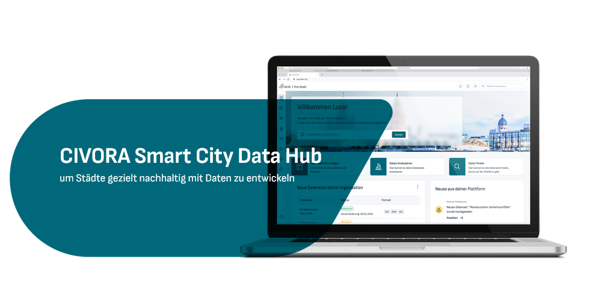
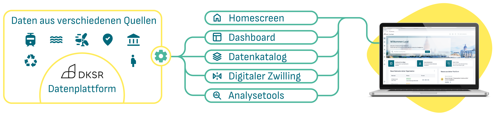

# CIVORA UI



Der CIVORA Data Hub ist eine Steuerzentrale für modulare urbane Datenlösungen. Er umfasst einen Datenkatalog auf piveau Basis, Dashboards, Analyse Tools sowie die Möglichkeit, über die Integration von GIS-Systemen und 3D-Modellen Digitale Zwillinge umzusetzen. Mit diesen Modulen können Sie Ihren Hub individuell ausstatten und zudem Daten aus unterschiedlichen Quellen anbinden. Der Hub ist mit einem systematischen Rollen- und Rechtesystem ausgestattet, das formelle Arbeitsweisen in Stadtverwaltungen abbildet. Er ermöglicht eine effiziente digitale Stadtverwaltung und eine Vielzahl an Smart City Anwendungen, wie Verkehrssteuerung oder Energiedaten-Management.



Für weitere Informationen und Kontakte: https://www.dksr.city/smart-city-data-hub-2/

Dies ist das Hauptrepository für die CIVORA UI Frontend Applikation.

## Konfiguration

CIVORA UI kann mittels verschiedener Konfigurationsvariablen auf individuelle Kundenanforderungen angepasst werden. In Produktionsumgebungen erfolgt die Konfiguration über Umgebungsvariablen. In Entwicklungsumgebungen wird die Datei `config/config.dev.js` geladen. 
Für mehr Informationen zu verfügbaren Variablen, s. [config.js](config/config.js).

Das [config Verzeichnis](config) kann in Kunden- oder Projektspezifische Unterverzeichnisse aufgeteilt werden. Während der Entwicklung kann zwischen diesen Projekten durch Nutzen des `change-project.sh` Skriptes oder `pnpm` gewechselt werden.

```shell
pnpm change-project <projekt-name>
```

Alternativ kann die Konfiguration auch direkt aus der Projektkonfiguration `config/<projekt-name>/config.js` in `config/config.dev.js` kopiert werden.

### Benutzerdefinierte Impressumsseiten

Benutzerdefinierte Impressumsseiten können als Vue-Komponenten zu `config/{customer-name}/components/data-notices/` hinzugefügt werden. Vier Komponenten werden automatisch integriert, sofern sie vorhanden und entsprechend benannt sind: `LegalNotice.vue`, `PrivacyPolicy.vue`, `TermsOfUse.vue`, und `AccessibilityInfo.vue`.

### Benutzerdefiniertes favicon

Das verwendete Favicon ist austauschbar. Momentan werden nur `.png` Favicons unterstützt. Nach Ablage des Favicons in `config/{projekt-name}/assets/favicon.png` wird es automatisch in der Produktionsumgebung verwendet. Für weitere Informationen zur Funktionsweise, s. [runtimeConfig.sh](./runtimeconfig.sh).

INFO: Der Konfigurationsparameter `faviconFileName` wird momentan nicht unterstützt. 

### Benutzerdefinierte Info-Seiten

Zusätzliche benutzerdefinierte Info-Seiten können als Tabs eingebunden werden.
Dazu erstellen Sie zunächst Vue Komponenten mit den Inhalten dieser Seiten in `config/{customer-name}/components/app-info/`. Exportieren Sie diese anschließend als `InfoTab`-Array in `config/{customer-name}/components/app-info/index.ts`.

Benutzerdefinierte Info-Seiten können zur Laufzeit individuell über den Konfigurationsparameter `customer.infoPages` oder die Umgebungsvariable `VITE_CUSTOMER_INFO_PAGES` aktiviert werden. Übergeben Sie entweder
- eine kommaseparierte Liste von `InfoTab`-IDs, die für den Kunden verfügbar sind, z. B. `Interfaces,FAQ` oder nur `Interfaces`
- das Wildcard-Zeichen `*`, um alle verfügbaren Info-Seiten zu aktivieren
- oder einen leeren String, um die Info-Seite leer zu lassen

### Nutzer Dashboard

Die CIVORA Startseite zeigt eine konfigurierbare Liste von Widgets in einem Nutzer-Dashboard an, sobald sich ein Nutzer angemeldet hat. Die angezeigten Widgets und ihre Reihenfolge werden durch Übergeben einer durch Kommas getrennten Liste aktiver Widgets mit dem Parameter `customer.modules.home.widgets` konfiguriert. Zusätzliche Parameter können bei Bedarf nach einem Leerzeichen für ein bestimmtes Widget übergeben werden.

Beispiel Konfigurationsausschnitt mit Dashboard-Widget für Dashboard mit der Id 115, das Widget für Neuigkeiten über Organisationsdatensätze und das Widget für allgemeine Neuigkeiten aus der Plattform:
```js
supersetUrl: 'https://superset.example.url',
customer: {
  modules: {
    home: {
      widgets: 'dashboard 115,orgnews,news'
    }
  }
}
```

Folgende Widgets sind verfügbar:
- `news` für allgemeine Nachrichten aus der Plattform
- `orgnews` für Neuigkeiten über Organisationsdatensätze, benötigt zusätzlich das Datenkatalog Modul
- `dashboard` zur Einbettung von Dashboards, benötigt die Einbindung von Superset über `supersetUrl` und einen weiteren Parameter dashboard id
- `iframe` zur Einbettung von Webseiten/URLs als Iframe, benötigt den weiteren Parameter iframe url

### Tracking Embed-Code

Eine generische Integration mit verschiedenen Tracking- und Analytics-Anbietern kann aktiviert werden, indem Tracking-Embed-Code über den Konfigurationsparameter `trackingEmbedCode` bereitgestellt wird. Dieser Parameter wird zur Laufzeit geparst und der Inhalt wird unverändert in den HTML-Head der Seite eingefügt.

Aufgrund der Natur von SPAs kann eine leichte Anpassung dieses Codes erforderlich sein. Damit Tracking auch bei Navigation innerhalb der Applikation erhalten bleibt, löst CIVORA UI bei jeder Navigation das Custom Event `vue-router-navigated` aus. Der Tracking-Embed-Code muss auf dieses Event reagieren.

Beispiel bei Nutzung von Matomo: Um bei Navigation in der Applikation zu tracken, ergänzen Sie den bereitgestellten Tracking-Code um folgenden Ausschnitt:
```javascript
  window.addEventListener('vue-router-navigated', (event) => {
    _paq.push(['setCustomUrl', window.location.pathname + window.location.search]);
    _paq.push(['setDocumentTitle', document.title]);
    _paq.push(['trackPageView']);
  });
```

### Neues CIVORA UI Design

Für einige Komponenten kann ein alternatives, neueres Design über den Konfigurationsparamter `customer.useNewCivoraUi` eingeschaltet werden.

## Verwendung

CIVORA UI verwendet `pnpm` für das Verwalten von Abhängigkeiten und Ausführen der Applikation.

### Abhängigkeiten installieren

```sh
pnpm install
```

### Lokal in der Entwicklungsumgebung ausführen

```shell
pnpm run dev
```

### Kompilieren für die Produktionsumgebung

```sh
pnpm build-with-piveau
```

## CI/CD

Die CI-Automatisierung ist so konfiguriert, dass sie nur dann ein Docker-Image erstellt und ein Helm-Chart freigibt/veröffentlicht, wenn ein Standard-Zweig oder ein Tag zu einem Commit erfolgt oder wenn die Variable `MANUAL_BUILD_BRANCH` manuell in der neu erstellten Pipeline gesetzt wird.

Die Pipeline verwendet [apache/skywalking-eyes](https://github.com/apache/skywalking-eyes), um Lizenz-Header zu prüfen, zu korrigieren, und bei Bedarf hinzuzufügen. Sie können dieses Tool auch lokal ausführen, zum Beispiel mit Docker:

```shell
# https://github.com/apache/skywalking-eyes?tab=readme-ov-file#docker-image

# prüfen
docker run -it --rm -v $(pwd):/github/workspace apache/skywalking-eyes header check

# korrigieren oder hinzufügen
docker run -it --rm -v $(pwd):/github/workspace apache/skywalking-eyes header fix
```

## Tests

CIVORA UI verfügt sowohl über Unit- als auch über Integrationstests.

### Unit-Tests

Tests ausführen:
```shell
pnpm test:unit run
```

Code-Coverage:
```shell
pnpm coverage
```

### Integrationstests

Wenn Sie die Tests lokal ausführen, stellen Sie sicher, dass Ihre Umgebung entsprechend eingerichtet ist. Lokal ausgeführte Integrationstests verwenden standardmäßig `config.dev.js`. Weitere Informationen finden Sie in `playwright.config.ts`.

Tests ausführen:
```shell
pnpm test:e2e

# optional mit zusätzlichen Optionen
pnpm test:e2e --reporter=list
```

## Lizenz

GNU Affero General Public License v3.0, eine Kopie ist in der Datei `LICENSE` enthalten.

**Open Source License (AGPL-3.0)**
   You may use, modify, and distribute this software under the terms of the GNU Affero General Public License v3.0.
   A copy of this license is included in the `LICENSE` file.

By using this software under the AGPL, you agree to share modifications made to it.

CIVORA ist eine eingetragene Marke der DKSR GmbH.
Der CIVORA Sourcecode wird unter den Bedingungen der AGPL v3.0 veröffentlicht, aber diese Lizenz gewährt keine Rechte zur Verwendung des CIVORA Namens oder Logos.
Jegliche öffentliche Verwendung des Namens oder des Markenzeichens in abgeleiteten Werken oder Diensten erfordert die vorherige schriftliche Genehmigung der DKSR GmbH.

Ein Produkt von

[](https://www.dksr.city/)