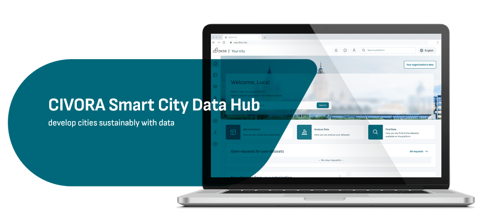
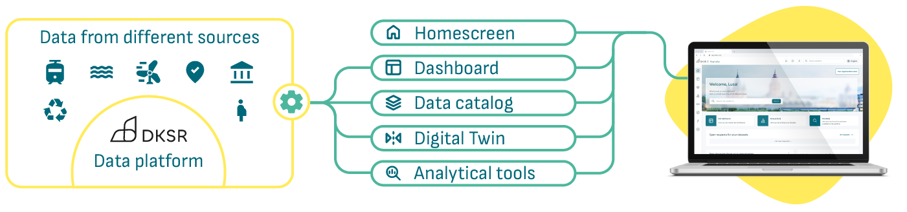

# CIVORA UI

[DE Version](README-DE.md)



The CIVORA Data Hub is a control centre for working with urban data. It includes an urban data catalogue, dashboards and analysis tools, including the potential to create and operate digital city twins. These modules allow you to customize your hub and also connect data from different sources. The hub is equipped with a systematic role-based access control system that reflects the formal working methods of municipal authorities. It enables efficient data management and a wide range of smart city applications, from traffic control to energy data management.



For more information and contacts, please visit: https://www.dksr.city/en/smart-city-data-hub-2/

This is the main repository for the CIVORA UI Frontend web application.

For an overview of how the application is built, configured and structured, see [docs/ARCHITECTURE.md](docs/ARCHITECTURE.md). A reverse-engineering case study of a live deployment (Datenraum Augsburg) with its public API contracts lives in [docs/reverse-engineering/augsburg](docs/reverse-engineering/augsburg/README.md).

## Configuration

CIVORA UI can be configured to tailor to individual customer requirements using a number of variables. In production deployments, these can be provided using environment variables. During development a `config/config.dev.js` file is used. More information about the configuration variables can be found in [config.js](config/config.js)

The [config directory](config) may contain a number of subdirectories, one for each customer and/or project. During development, you can switch customer projects by using the `change-project.sh` script directly or through pnpm

```shell
pnpm change-project <project-name>
```

Alternatively, you can switch customer projects by copying the contents of its `config/{customer-name}/config.js` into `config/config.dev.js`.

### Custom Legal Notices

Custom legal notice pages can be added as Vue components to `config/{customer-name}/components/data-notices/`. Four data notice components are integrated automatically if present and named accordingly: `LegalNotice.vue`, `PrivacyPolicy.vue`, `TermsOfUse.vue`, and `AccessibilityInfo.vue`.

### Custom favicon

The favicon can be customized. For now, only png favicons are supported. Add the custom favicon in `config/{customer-name}/assets/favicon.png` and it will be used automatically. Also see [runtimeConfig.sh](./runtimeconfig.sh) for more info.

NOTE: The `faviconFileName` parameter is currently unsupported.

### Custom Info Pages

Additional custom info pages can be included as tabs.
To do so, first create vue SFCs with the content of these pages in `config/{customer-name}/components/app-info/`. Then export default these as an `InfoTab` array in `config/{customer-name}/components/app-info/index.ts`

Custom info pages can be individually toggled at runtime using the `customer.infoPages` configuration parameter or `VITE_CUSTOMER_INFO_PAGES` environment variable. Pass either
  - a comma-separated list of `InfoTab` Ids that are available to the customer, e.g. `Interfaces,FAQ` or only `Interfaces`
  - the wildcard `*` character to enable all available info pages
  - or an empty string to leave the info page empty

### User dashboard

The CIVORA home view displays a configurable list of widgets in a user-dashboard once a user is logged in. Available widgets and their order is configured by passing a comma-separated list of enabled widgets with the `customer.modules.home.widgets` parameter. Additional parameters, if required, can be passed after a whitespace character for a particular widget.

Example configuration snippet: Dashboard widget embedding dashboard with id 115, organizational news widget, and platform news widget:
```js
supersetUrl: 'https://superset.example.url',
customer: {
  modules: {
    home: {
      widgets: 'dashboard 115,orgnews,news'
    }
  }
}
```

Available widgets are:
- `news` for platform news
- `orgnews` for news about organizational datasets, requires data catalog module to be enabled
- `dashboard` to embed superset dashboards, requires `supersetUrl` to be configured and additional parameter dashboard id
- `iframe` to embed URLs as iframes, requires additional parameter iframe url

### Tracking embed code

Generic integration with various tracking and analytics providers can be enabled by supplying the tracking embed code via the `trackingEmbedCode` configuration parameter. This parameter is parsed at runtime and the contents are added verbatim to the html head of the page.

Due to the nature of SPAs, a slight modification of this code may be required. To sustain tracking when navigating through the application, CIVORA UI dispatches a `vue-router-navigated` custom event on every navigation. The tracking embed code needs to listen and react to this event.

For instance if using the Matomo web analytics application: To track while navigating through the application, handle and react to the `vue-router-navigated` event by appending this code snippet to the provided tracking code:
```javascript
  window.addEventListener('vue-router-navigated', (event) => {
    _paq.push(['setCustomUrl', window.location.pathname + window.location.search]);
    _paq.push(['setDocumentTitle', document.title]);
    _paq.push(['trackPageView']);
  });
```

### Toggle new CIVORA UI

Toggle the new design using `customer.useNewCivoraUi` configuration variable.

## Usage

Install and run CIVORA UI using `pnpm`

### Install dependencies

```sh
pnpm install
```

### Run local dev environment

```shell
pnpm run dev
```

### Compile and Minify for Production with Piveau Vue components

```sh
pnpm build-with-piveau
```

## CI/CD

The CI automation is configured to only build a docker image and release/publish a helm chart in case of default branch
or a tag to a commit happened or if the variable `MANUAL_BUILD_BRANCH` is set manually within new pipeline created.

The pipeline uses [apache/skywalking-eyes](https://github.com/apache/skywalking-eyes) to check and fix license headers. You can run this tool locally as well, for instance using docker:

```shell
# https://github.com/apache/skywalking-eyes?tab=readme-ov-file#docker-image

# to check license headers
docker run -it --rm -v $(pwd):/github/workspace apache/skywalking-eyes header check

# to fix license headers
docker run -it --rm -v $(pwd):/github/workspace apache/skywalking-eyes header fix
```

## Testing

CIVORA UI has both unit and integration tests.

### Unit tests

Run the tests:
```shell
pnpm test:unit run
```

Code coverage:
```shell
pnpm coverage
```

### Integration tests

If running the tests locally, ensure your environment is set up. Locally run integration tests use `config.dev.js` by default. See also `playwright.config.ts` for more information.

To run the tests, use:
```shell
pnpm test:e2e

# you can also pass options
pnpm test:e2e --reporter=list
```

## License

**Open Source License (AGPL-3.0)**
   You may use, modify, and distribute this software under the terms of the GNU Affero General Public License v3.0.
   A copy of this license is included in the `LICENSE` file.

By using this software under the AGPL, you agree to share modifications made to it.

CIVORA is a registered trademark of DKSR GmbH.
The CIVORA codebase is published under the terms of the AGPL v3.0, but this license does not grant any rights to use the CIVORA name or logo.
Any public use of the name or branding in derivative works or services requires prior written permission from DKSR GmbH.

A product by

[](https://www.dksr.city/en/)